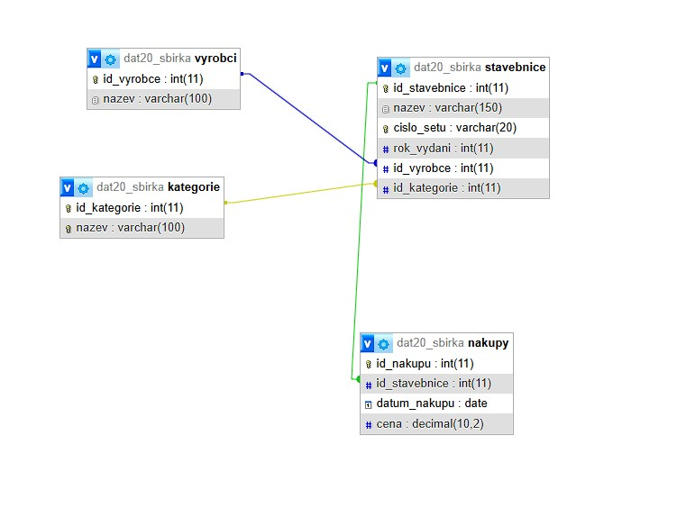

# DAT20 – Evidence sbírky LEGO a COBI

## 1. Popis projektu

Tento projekt představuje **relační databázi** určenou k evidenci sbírky stavebnic LEGO a COBI. Databáze eviduje výrobce, kategorie, jednotlivé stavebnice a jejich nákupy.

Projekt vznikl jako semestrální práce do předmětu **DAT20 – Databázové systémy**.

## 2. Použité technologie

- **MariaDB** – relační databázový server
- **XAMPP** – lokální prostředí pro spuštění serveru
- **phpMyAdmin** – správa databáze a testování SQL dotazů
- **Visual Studio Code** – psaní SQL skriptů a dokumentace
- **GitHub** – uložení a odevzdání projektu

## 3. Struktura databáze

Databáze `dat20_sbirka` obsahuje **čtyři propojené tabulky**.

### 3.1 Tabulka `vyrobci`

Evidence výrobců, například LEGO a COBI.

| Sloupec | Datový typ | Účel |
|---|---|---|
| `id_vyrobce` | `INT` | Primární klíč (`PRIMARY KEY`), automatické číslování |
| `nazev` | `VARCHAR(100)` | Povinný název výrobce |

### 3.2 Tabulka `kategorie`

Kategorie stavebnic, například Star Wars, WWII nebo Speed Champions.

| Sloupec | Datový typ | Účel |
|---|---|---|
| `id_kategorie` | `INT` | Primární klíč, automatické číslování |
| `nazev` | `VARCHAR(100)` | Povinný a unikátní název kategorie |

### 3.3 Tabulka `stavebnice`

Evidence jednotlivých stavebnic.

| Sloupec | Datový typ | Účel |
|---|---|---|
| `id_stavebnice` | `INT` | Primární klíč, automatické číslování |
| `nazev` | `VARCHAR(150)` | Název stavebnice |
| `cislo_setu` | `VARCHAR(20)` | Jedinečné číslo setu |
| `rok_vydani` | `INT` | Rok vydání |
| `id_vyrobce` | `INT` | Cizí klíč na tabulku `vyrobci` |
| `id_kategorie` | `INT` | Cizí klíč na tabulku `kategorie` |

### 3.4 Tabulka `nakupy`

Evidence nákupů stavebnic.

| Sloupec | Datový typ | Účel |
|---|---|---|
| `id_nakupu` | `INT` | Primární klíč, automatické číslování |
| `id_stavebnice` | `INT` | Cizí klíč na tabulku `stavebnice` |
| `datum_nakupu` | `DATE` | Datum nákupu |
| `cena` | `DECIMAL(10,2)` | Nákupní cena |

## 4. Vztahy mezi tabulkami

Všechny tři vztahy jsou typu **1:N (jeden ku mnoha)**:

1. `vyrobci` → `stavebnice`: jeden výrobce může mít více stavebnic.
2. `kategorie` → `stavebnice`: jedna kategorie může obsahovat více stavebnic.
3. `stavebnice` → `nakupy`: jedna stavebnice se může objevit ve více nákupech.

Propojení je zajištěno pomocí primárních (`PRIMARY KEY`) a cizích klíčů (`FOREIGN KEY`).

## 5. Testovací data

| Tabulka | Počet záznamů |
|---|---:|
| `vyrobci` | 2 |
| `kategorie` | 6 |
| `stavebnice` | 20 |
| `nakupy` | 5 |

Výrobci jsou **LEGO** a **COBI**. Kategorie zahrnují Star Wars, WWII, WWI, Vietnam War, Armed Forces a Speed Champions. Data a ceny nákupů jsou fiktivní a slouží k testování SQL dotazů.

## 6. SQL dotazy

Soubor `03_sql_dotazy.sql` obsahuje osm ověřených příkladů:

1. **INNER JOIN** – seznam stavebnic s výrobci.
2. **LEFT JOIN** – všechny kategorie a jejich stavebnice.
3. **GROUP BY + COUNT** – počet stavebnic podle výrobce.
4. **SUM** – součet nákupních cen.
5. **AVG** – průměrná nákupní cena.
6. **GROUP BY + HAVING** – kategorie s více než dvěma stavebnicemi.
7. **JOIN + GROUP BY** – počet nákupů a útrata podle výrobce.
8. **Poddotaz** – nákupy s cenou nad průměrem.

### Ukázka dotazu

```sql
SELECT
    v.nazev AS vyrobce,
    COUNT(s.id_stavebnice) AS pocet_stavebnic
FROM vyrobci v
INNER JOIN stavebnice s
    ON v.id_vyrobce = s.id_vyrobce
GROUP BY v.id_vyrobce, v.nazev
ORDER BY pocet_stavebnic DESC;
```

Výsledek v testovací databázi: **COBI – 11 stavebnic, LEGO – 9 stavebnic**.

## 7. Spuštění projektu

1. Spusťte **Apache** a **MySQL (MariaDB)** v aplikaci XAMPP.
2. Otevřete `http://localhost/phpmyadmin/`.
3. Na úrovni serveru importujte soubor `01_databaze.sql`, který vytvoří databázi a tabulky.
4. Spusťte soubor `02_testovaci_data.sql` pro vložení testovacích dat.
5. Jednotlivé dotazy ze souboru `03_sql_dotazy.sql` spouštějte v záložce **SQL**.

**Upozornění:** Postup je určen pro dosud nenaplněnou databázi. Opakované spuštění příkazů `INSERT INTO` by mohlo způsobit duplicity nebo chyby unikátních klíčů.

### Soubory projektu

| Soubor | Popis |
|---|---|
| `01_databaze.sql` | DDL: vytvoření databáze a tabulek |
| `02_testovaci_data.sql` | DML: vložení testovacích záznamů |
| `03_sql_dotazy.sql` | Osm SQL dotazů |
| `er_diagram.jpg` | ER diagram databáze |
| `README.md` | Tato dokumentace |

## 8. ER diagram

Následující diagram znázorňuje čtyři tabulky a jejich vztahy:



## 9. Normalizace

Databáze byla navržena s cílem omezit redundanci
(opakování údajů) a zajistit konzistenci dat.

### 9.1 První normální forma (1NF)

Každá tabulka obsahuje jednoznačně identifikovatelné
řádky a jednotlivé sloupce obsahují atomické hodnoty.

Například tabulka `stavebnice` eviduje samostatně
název, číslo setu, rok vydání a identifikátory
výrobce a kategorie.

### 9.2 Druhá normální forma (2NF)

Databáze splňuje 1NF a neklíčové atributy
nezávisí pouze na části složeného kandidátního klíče.

Všechny čtyři tabulky používají jednoduché
jednosloupcové primární klíče:

- `id_vyrobce`
- `id_kategorie`
- `id_stavebnice`
- `id_nakupu`

Díky tomu nevznikají částečné závislosti
na složených primárních klíčích.

### 9.3 Třetí normální forma (3NF)

Databáze splňuje 2NF a neklíčové atributy
nejsou tranzitivně závislé na klíčích.

Údaje o výrobcích jsou uloženy v tabulce
`vyrobci` a údaje o kategoriích v tabulce
`kategorie`.

Tabulka `stavebnice` obsahuje pouze cizí klíče
odkazující na výrobce a kategorie.

Informace o jednotlivých nákupech, jako jsou
datum a cena, jsou vedeny samostatně
v tabulce `nakupy`.

### 9.4 Závěr normalizace

Podle navržené struktury a předpokládaných
funkčních závislostí databáze splňuje
požadavky 1NF, 2NF a 3NF.

Oddělení údajů do čtyř tabulek omezuje
opakování dat a usnadňuje jejich správu.
